# Passo Seguro — Applied Computer Vision

Detector de problemas em calçadas de São Paulo. Um YOLO ajustado classifica cada relato do app
(foto) e roda em tempo real num vídeo de caminhada, entregando a classe e a posição de cada
problema ao Passo Seguro para triagem e priorização.

Ficha Técnica: [README do repositório principal](https://github.com/Passo-Seguro/passo-seguro#ficha-técnica)

## Integrantes
| Nome completo | RM |
|---|---|
| Guilherme Morais | 551981 |
| Júlia Marques | 98680 |
| Matheus Gusmão | 550826 |

## Sumário

1. [Objetivo](#1-objetivo)
2. [Resultados](#2-resultados)
3. [Requisitos e máquina usada](#3-requisitos-e-máquina-usada)
4. [Instalação](#4-instalação)
5. [Como usar o serviço `POST /deteccoes`](#5-como-usar-o-serviço-post-deteccoes)
6. [Como treinar e avaliar (pipeline completo)](#6-como-treinar-e-avaliar-pipeline-completo)
7. [Testes](#7-testes)
8. [Registro da execução de 08/11/2026](#8-registro-da-execução-de-08112026)
9. [Dados, licenças e LGPD](#9-dados-licenças-e-lgpd)
10. [Estrutura do repositório](#10-estrutura-do-repositório)
11. [Solução de problemas](#11-solução-de-problemas)
12. [Links](#12-links)

---

## 1. Objetivo

Treinar um detector de objetos para identificar, em fotos e em vídeo em tempo real, quatro
problemas de calçada em São Paulo: **buraco**, **piso danificado**, **obstáculo** e **veículo na
calçada**. O serviço roda em CPU com o ONNX Runtime, sem PyTorch e sem Ultralytics em produção.

## 2. Resultados

> Conjunto de **teste** (251 imagens), de [`resultados/comparacao.md`](resultados/comparacao.md).
> Execução de 08/11/2026 **só com datasets públicos** (sem fotos de SP): `obstaculo` e
> `veiculo_na_calcada` ainda não têm exemplos e não são detectados. Os números medem buraco e
> piso danificado em fotos de rua de outros países, não o desempenho em SP.

| Modelo | mAP50 | mAP50-95 | Precisão | Recall | buraco mAP50 | piso danificado mAP50 | Latência CPU p95 (1 thread) |
|---|---|---|---|---|---|---|---|
| YOLO11n baseline (20 épocas) | 0,638 | 0,353 | 0,726 | 0,610 | 0,560 | 0,716 | – |
| YOLO11n final | 0,655 | 0,408 | 0,724 | 0,643 | 0,580 | 0,730 | – |
| **YOLO11s final (no ar)** | **0,679** | **0,419** | **0,764** | **0,660** | 0,583 | 0,775 | 90 ms |

**Modelo escolhido: small.** Tem o maior mAP50-95 no teste, e a latência em CPU fica bem abaixo
de 1 s: 87 ms com 1 thread e 34 ms com 4. No vídeo, roda a 31 FPS em CPU.

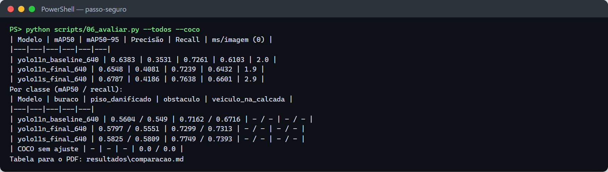

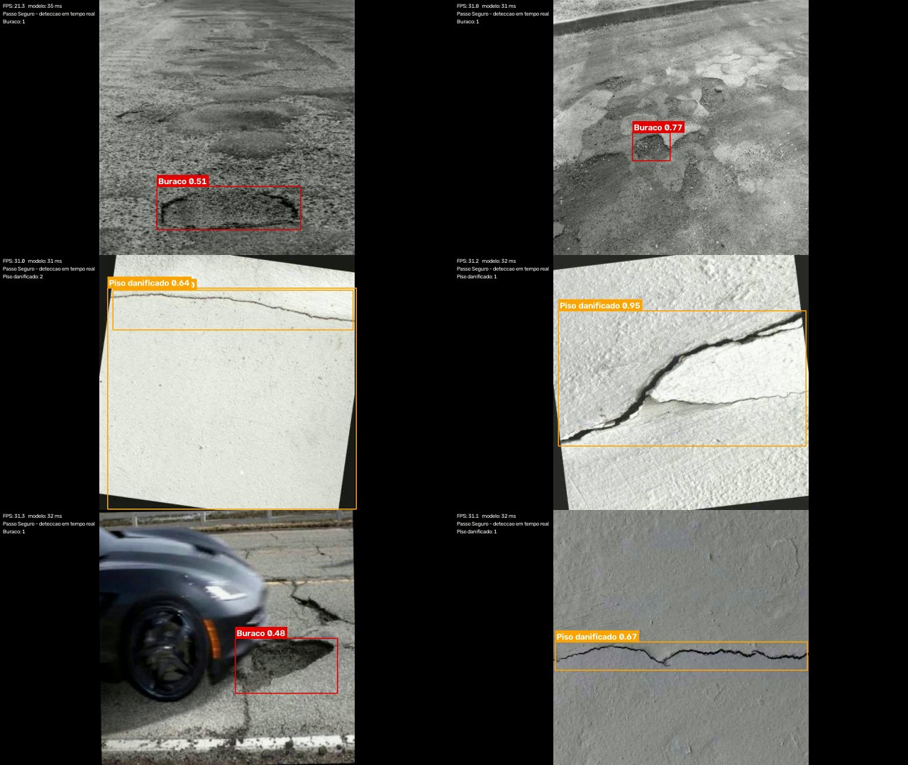

Vídeo da solução: _link do YouTube (não listado)_ · Relatório: [`docs/relatorio.md`](docs/relatorio.md) ·
Roteiro do vídeo: [`docs/roteiro-video.md`](docs/roteiro-video.md)

## 3. Requisitos e máquina usada

**Mínimo para usar o serviço:** Python 3.11 ou 3.12 e 2 GB de RAM, ou Docker. Roda em CPU.

**Para treinar:** GPU NVIDIA (4 GB de VRAM ou mais) com driver 580 ou mais novo para CUDA 13. Sem
GPU o treino funciona, mas leva horas (use `--modelo n --imgsz 512 --batch 8`).

**Máquina usada no treino e em todos os testes deste repositório:**

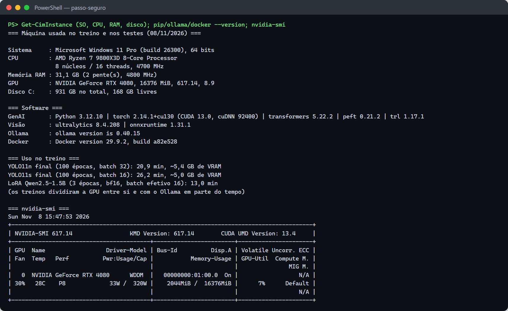

| Item | Usado |
|---|---|
| Sistema | Windows 11 Pro 64 bits (build 26300) |
| CPU | AMD Ryzen 7 9800X3D, 8 núcleos / 16 threads |
| RAM | 31 GB |
| GPU | NVIDIA GeForce RTX 4080, 16 GB, driver 617.14, CUDA 13.0 |
| Software | Python 3.12.10, PyTorch 2.14.1+cu130, Ultralytics 8.4.208, ONNX Runtime 1.31.1, Docker 29.9.2 |
| Tempo de treino | nano 20,9 min (~5,4 GB de VRAM, batch 32); small 26,2 min (~5,0 GB, batch 16) |

## 4. Instalação

Os comandos estão em PowerShell (Windows). No Linux ou no Mac, troque
`.venv\Scripts\Activate.ps1` por `source .venv/bin/activate`.

**Só para usar o serviço** (o modelo `modelos/detector.onnx` já vem no repositório):

```powershell
git clone https://github.com/Passo-Seguro/passo-seguro-visao
cd passo-seguro-visao
python -m venv .venv
.venv\Scripts\Activate.ps1
pip install -r requirements/servico.txt
```

**Para treinar e avaliar:**

```powershell
python -m venv .venv
.venv\Scripts\Activate.ps1                # erro de política: Set-ExecutionPolicy -Scope CurrentUser RemoteSigned
python -m pip install --upgrade pip

# PyTorch com CUDA primeiro (senão o pip instala a versão só-CPU).
# cu130 exige driver NVIDIA 580 ou mais novo; com driver antigo use .../whl/cu126.
pip install torch torchvision --index-url https://download.pytorch.org/whl/cu130
# sem placa NVIDIA:  pip install torch torchvision

pip install -r requirements/base.txt
pip install -r requirements/dev.txt
python -c "import torch; print(torch.__version__, torch.cuda.is_available())"   # tem de sair True
python scripts/00_verificar_ambiente.py   # mostra a GPU, a VRAM e o batch sugerido
python -m pytest -q                       # 21 testes
```

No VS Code, escolha o interpretador `.venv` (`Ctrl+Shift+P` → **Python: Select Interpreter**).

## 5. Como usar o serviço `POST /deteccoes`

O serviço recebe a foto de um relato e devolve os problemas encontrados, com classe, confiança e
posição. O contrato é o do [`openapi.yaml`](https://github.com/Passo-Seguro/passo-seguro/blob/main/openapi.yaml)
do repositório principal (operação `detectarProblemas`).

### 5.1 Subir o serviço

**Local:**

```powershell
.venv\Scripts\Activate.ps1
$env:VISAO_TOKEN="token-local"
uvicorn servico.app:app --port 8001
```

**Docker** (imagem de 531 MB, com o modelo dentro):

```powershell
docker build -f deploy/Dockerfile -t ghcr.io/passo-seguro/passo-seguro-visao:local .
docker run --rm -p 8001:8000 -e VISAO_TOKEN=token-local ghcr.io/passo-seguro/passo-seguro-visao:local
```

A documentação interativa (Swagger) fica em <http://localhost:8001/docs>:

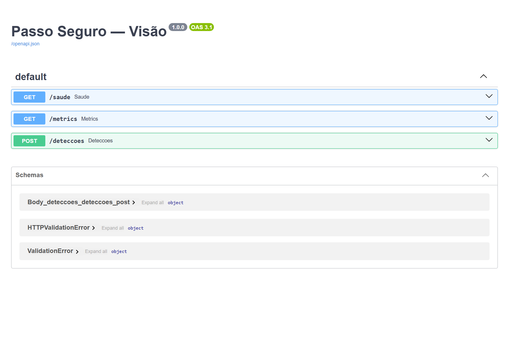

**Integração com a API principal** (a combinar com a Júlia):

- Na API, configure `VISAO_URL=http://<host-do-servico>:8000` e o mesmo `VISAO_TOKEN`.
- No `infra/apps.tf` ainda não há Container App para a visão. É preciso criar um com ingress
  interno, `min_replicas = 1` (a partida a frio passa dos 5 s de timeout da API) e 1 vCPU / 2 GB.

### 5.2 Contrato

**Requisição:** `multipart/form-data` com o campo `imagem` (JPEG ou PNG, até 10 MB) e o cabeçalho
`Authorization: Bearer <VISAO_TOKEN>`.

**Resposta 200:** lista da maior para a menor confiança; lista vazia quando nada passa do limiar.

```json
[
  {"classe": "buraco", "confianca": 0.805, "caixa": {"x": 0.3331, "y": 0.4182, "largura": 0.3729, "altura": 0.2552}},
  {"classe": "buraco", "confianca": 0.7028, "caixa": {"x": 0.4035, "y": 0.1086, "largura": 0.2167, "altura": 0.0748}}
]
```

| Campo | Tipo | Significado |
|---|---|---|
| `classe` | string | `buraco`, `piso_danificado`, `obstaculo` ou `veiculo_na_calcada` |
| `confianca` | número 0..1 | sempre ≥ `LIMIAR_CONFIANCA` (padrão 0,4) |
| `caixa.x`, `caixa.y` | número 0..1 | canto **superior esquerdo**, como fração da largura e da altura da foto |
| `caixa.largura`, `caixa.altura` | número 0..1 | tamanho como fração da foto |

Para desenhar a caixa numa imagem de `W × H` pixels: `x * W`, `y * H`, `largura * W`, `altura * H`.
A foto é lida com a orientação do EXIF aplicada; os metadados não são guardados nem registrados.

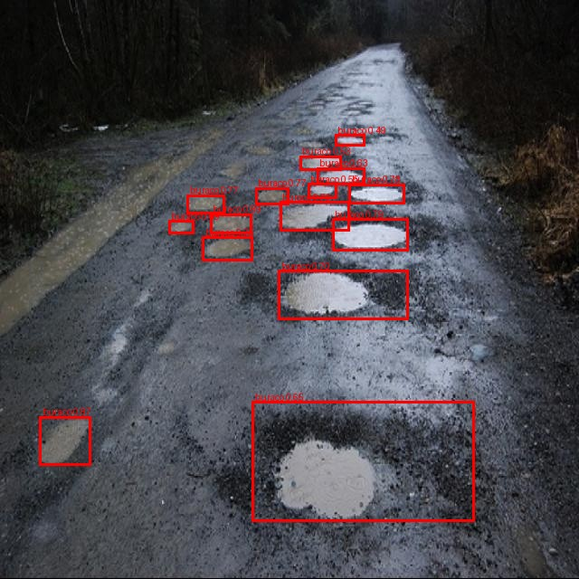

### 5.3 Exemplos de chamada

**curl:**

```bash
curl -H "Authorization: Bearer token-local" -F "imagem=@foto.jpg;type=image/jpeg" http://localhost:8001/deteccoes
```

**Python:**

```python
import httpx

with open("foto.jpg", "rb") as f:
    r = httpx.post("http://localhost:8001/deteccoes",
                   headers={"Authorization": "Bearer token-local"},
                   files={"imagem": ("foto.jpg", f, "image/jpeg")}, timeout=5)
r.raise_for_status()
for d in r.json():
    print(d["classe"], d["confianca"], d["caixa"])
```

**JavaScript:**

```js
const form = new FormData();
form.append("imagem", arquivo); // File/Blob JPEG ou PNG
const r = await fetch("http://localhost:8001/deteccoes", {
  method: "POST", headers: { Authorization: "Bearer token-local" }, body: form,
});
const deteccoes = await r.json(); // [] quando nada passa do limiar
```

**Desenhar as caixas (Pillow):**

```python
from PIL import Image, ImageDraw

img = Image.open("foto.jpg"); W, H = img.size
desenho = ImageDraw.Draw(img)
for d in r.json():
    c = d["caixa"]; x0, y0 = c["x"] * W, c["y"] * H
    desenho.rectangle([x0, y0, x0 + c["largura"] * W, y0 + c["altura"] * H], outline="red", width=4)
    desenho.text((x0 + 4, y0 + 4), f'{d["classe"]} {d["confianca"]:.2f}', fill="red")
img.save("foto_anotada.jpg")
```

**Sem o serviço, direto no código:**

```python
from visao.classes import carregar_classes
from visao.detector_onnx import DetectorOnnx
from visao.imagens import abrir_rgb

det = DetectorOnnx("modelos/detector.onnx", carregar_classes(), limiar_confianca=0.4, limiar_iou=0.45)
for d in det.detectar(abrir_rgb(open("foto.jpg", "rb").read())):
    print(d.para_contrato())
```

Chamadas reais ao serviço (local e container):

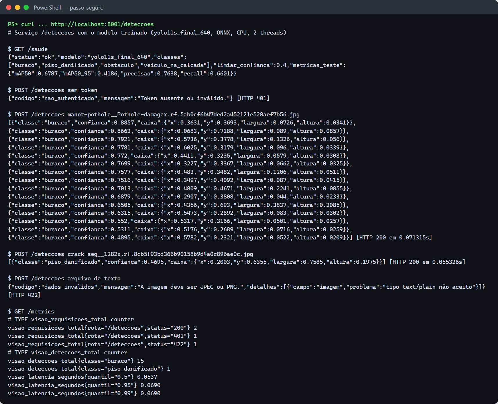

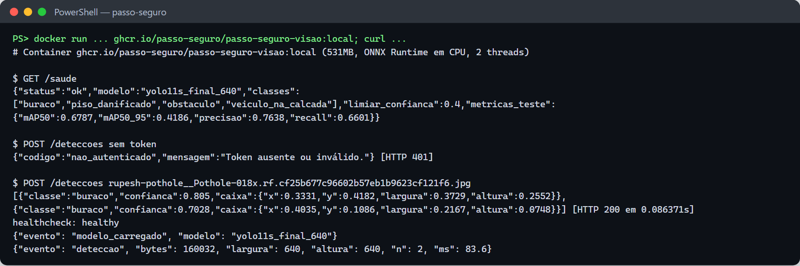

### 5.4 Erros, saúde e métricas

Todos os erros usam o formato `{"codigo", "mensagem", "detalhes"?}`.

| Status | `codigo` | Quando |
|---|---|---|
| 400 | `requisicao_invalida` | falta o campo `imagem` ou o corpo não é multipart |
| 401 | `nao_autenticado` | sem token ou token errado |
| 413 | `arquivo_grande` | arquivo maior que 10 MB |
| 422 | `dados_invalidos` | tipo diferente de JPEG/PNG, arquivo vazio ou imagem que não abre |
| 503 | `visao_indisponivel` | o modelo não carregou (veja `GET /saude`) |

Com 503 ou tempo esgotado (5 s), a API principal segue com o relato sem a classificação
automática.

- `GET /saude` (sem token): 200 com o modelo e as métricas de teste
  (`{"status": "ok", "modelo": "yolo11s_final_640", "metricas_teste": {"mAP50": 0.6787, ...}}`);
  503 sem modelo.
- `GET /metrics`: formato Prometheus (requisições por status, detecções por classe, latência p50,
  p95 e p99). Se `METRICS_TOKEN` estiver definido, pede esse token.
- **Log:** JSON, uma linha por detecção, só com tamanho, quantidade e tempo (nada da imagem).

### 5.5 Configuração

| Variável | Padrão | Para quê |
|---|---|---|
| `VISAO_TOKEN` | vazio | token Bearer, o mesmo da API principal. Vazio desliga a autenticação (com aviso no log) |
| `MODELO_PATH` | `modelos/detector.onnx` | caminho do modelo |
| `LIMIAR_CONFIANCA` | 0.4 | abaixo disso a detecção é descartada |
| `LIMIAR_IOU` | 0.45 | NMS: caixas da mesma classe com IoU maior viram uma só |
| `MAX_BYTES` | 10485760 | tamanho máximo do arquivo |
| `ONNX_THREADS` | 0 (todas) | threads do ONNX Runtime; ajuste às vCPUs do container |
| `METRICS_TOKEN` | vazio | protege o `GET /metrics` |
| `NIVEL_LOG` | INFO | nível do log |

### 5.6 Tempo real (webcam ou vídeo)

```powershell
python scripts/10_tempo_real.py --fonte 0                                                  # webcam
python scripts/10_tempo_real.py --fonte dados/videos/caminhada.mp4 --salvar resultados/demo.mp4  # vídeo
python scripts/10_tempo_real.py --fonte dados/videos/caminhada.mp4 --pt yolo11s_final_640        # GPU (PyTorch)
```

O FPS aparece no canto. O padrão usa o mesmo ONNX do serviço, em CPU. Grave a caminhada com o
celular na horizontal, na altura do peito, andando devagar.

## 6. Como treinar e avaliar (pipeline completo)

Cada script também é uma **tarefa do VS Code** (`Ctrl+Shift+P` → **Tasks: Run Task**).

### 6.1 Datasets públicos

**Sem login (pronto para usar):**

```powershell
python scripts/01a_baixar_publicos.py     # baixa e converte 4 datasets abertos
python scripts/01_importar_publicos.py    # remapeia para as 4 classes -> resultados/tabela_datasets.md
```

O `01a` baixa as rachaduras da Ultralytics e três datasets de buraco do Hugging Face, remove
imagens repetidas (dHash) e rótulos corrompidos e renomeia as fotos para que cópias da mesma foto
fiquem no mesmo split. Esses datasets só cobrem `buraco` e `piso_danificado`.

**Do Roboflow Universe** (exige login):

1. Procure por `pothole`, `sidewalk`, `sidewalk damage`, `pavement crack`, `obstacle sidewalk`,
   `car on sidewalk`. Prefira fotos de rua feitas a pé, não de drone nem de painel de carro.
2. **Anote a licença** (CC BY 4.0, CC0 e MIT servem; descarte NC se houver dúvida).
3. **Download Dataset** → formato **YOLOv8** → descompacte em `dados/brutos/publicos/<nome-curto>/`.
4. Preencha o bloco em `config/datasets.yaml` (url, licença, `remapear` de cada classe para uma
   das 4 classes ou `descartar`, `ativo: true`) e rode o `01`.

### 6.2 Fotos próprias e LGPD

Coloque as fotos originais em `dados/brutos/proprias/<trecho>/`, **uma pasta por trecho da
caminhada** (ex.: `paulista-trianon/`). São 300 fotos em 6 trechos ou mais.

```powershell
python scripts/02_preparar_fotos_proprias.py                              # borra rostos e placas, tira o GPS
python scripts/borrar_manual.py dados/intermediario/proprias/<trecho>/<foto>.jpg   # o que escapou
```

**Nunca** publique `dados/brutos/`: ele tem o GPS original e está no `.gitignore`.

### 6.3 Anotação (Roboflow ou CVAT)

```powershell
python scripts/03_pre_anotar.py           # pré-anota veículos com o YOLO do COCO
```

- **Apague** as caixas de carros parados corretamente na rua: só conta veículo **sobre a calçada**.
- **Desenhe** buraco, piso danificado e obstáculo, seguindo `config/classes.yaml`. Bueiro **sem
  tampa** é `buraco`; bueiro **tampado** não é nada (o falso positivo típico). Raiz levantando o
  piso é `piso_danificado`.
- **Roboflow:** projeto *Object Detection* com as 4 classes **nesta ordem**: `buraco`,
  `piso_danificado`, `obstaculo`, `veiculo_na_calcada`. Faça upload de
  `dados/pre_anotado/roboflow/`, gere a versão **sem** augmentation nem resize (só *Auto-Orient*),
  exporte em **YOLOv8** e descompacte em `dados/anotado/proprias/`.
- **CVAT:** importe `dados/pre_anotado/cvat_yolo_1.1.zip`, exporte em **YOLO 1.1** e descompacte
  em `dados/anotado/proprias/`.

### 6.4 Dataset final (70/20/10 por local)

```powershell
python scripts/04_montar_dataset.py       # -> dados/dataset/ e resultados/tabela_split.md
```

Fotos do mesmo trecho (ou cópias da mesma foto pública) ficam no mesmo split. Próprias e públicas
são divididas separadamente, para o teste sempre ter fotos de SP. O `--razao-max 3` equilibra as
classes no treino tirando imagens públicas da classe que sobra; as suas fotos nunca saem.

### 6.5 Treino

```powershell
python scripts/05_treinar.py --preset baseline            # 20 épocas do nano: prova o pipeline
python scripts/05_treinar.py --preset final --modelo n    # 100 épocas, imagem 640, parada antecipada
python scripts/05_treinar.py --preset final --modelo s
```

O batch é escolhido pela VRAM; com 4 GB ou menos use `--batch 8`. Se o treino cair, retome com
`--retomar --nome <execucao>`. `--do-zero` treina sem os pesos do COCO, para mostrar o ganho do
transfer learning. Se o baseline sair perto de zero, o problema está nos rótulos.

### 6.6 Teste e análise de erros

```powershell
python scripts/06_avaliar.py --todos --coco               # -> resultados/comparacao.md
python scripts/07_analise_erros.py --nome yolo11s_final_640
```

Abra as imagens de `resultados/<execucao>/erros/`, preencha a coluna `causa` do `erros.csv`
(sombra, bueiro_tampado, folhas…) e rode de novo com `--so-resumo`. Escolha o modelo de maior
mAP50-95 no teste, **desde que** a latência em CPU fique bem abaixo de 1 s.

**Plano B (mAP50 abaixo de 0,5):** junte mais datasets públicos, aumente o augmentation ou reduza
para 3 classes (ex.: juntando buraco e piso danificado). Mudar as classes exige mudar o contrato
no repositório principal.

### 6.7 ONNX e latência

```powershell
python scripts/08_exportar_onnx.py --nome yolo11s_final_640   # -> modelos/detector.onnx + detector.json
python scripts/09_latencia.py --threads 2                     # -> resultados/latencia_cpu.md
```

O `08` confere o ONNX contra o PyTorch em 5 imagens. Commite `modelos/detector.onnx` e
`modelos/detector.json`: o serviço e o Docker usam esses arquivos.

### 6.8 Entrega

O relatório está em [`docs/relatorio.md`](docs/relatorio.md), já no PDF que vai para o Teams:
[`docs/relatorio.pdf`](docs/relatorio.pdf). Depois de editar o Markdown (por exemplo, para pôr o
link do vídeo), gere o PDF de novo:

```powershell
python -m playwright install chromium     # uma vez
python scripts/gerar_relatorio_pdf.py     # docs/relatorio.md -> docs/relatorio.pdf
```

O vídeo de demonstração (2min07s) é montado a partir das saídas reais: o `10_tempo_real.py` e uma
chamada ao `POST /deteccoes` pelo Swagger. Ele fica em `docs/video/` (fora do git, como todo
`.mp4`) e vai para o YouTube como não listado. O roteiro para uma versão narrada está em
[`docs/roteiro-video.md`](docs/roteiro-video.md). Antes do push:

```powershell
python scripts/checar_lgpd.py      # nenhuma foto com GPS
python -m pytest -q
```

## 7. Testes

**21 testes, todos passando.** Conferem o serviço, o pós-processamento e a preparação dos dados
sem GPU e sem modelo treinado: um ONNX falso, com a mesma interface do YOLO exportado, é gerado
na hora ([`tests/conftest.py`](tests/conftest.py)).

```powershell
python -m pytest -v                                    # todos
python -m pytest tests/test_servico.py -v              # um arquivo
python -m pytest --html=docs/execucao/relatorio_testes.html --self-contained-html   # relatório HTML
```

No VS Code: aba **Testing**. Saída em [`docs/execucao/pytest.txt`](docs/execucao/pytest.txt) e relatório
em [`docs/execucao/relatorio_testes.html`](docs/execucao/relatorio_testes.html).

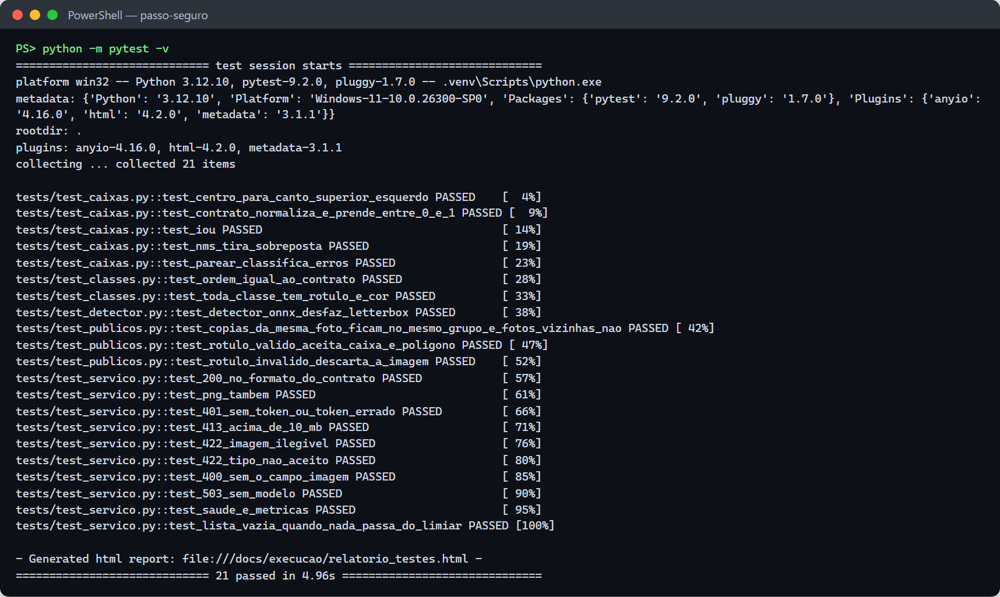

| Arquivo | Teste | O que garante |
|---|---|---|
| `test_servico.py` | `test_200_no_formato_do_contrato` | 200 com `[{classe, confianca, caixa}]`, da maior para a menor confiança |
| | `test_png_tambem` | PNG é aceito |
| | `test_401_sem_token_ou_token_errado` | sem token ou token errado → 401 |
| | `test_413_acima_de_10_mb` | arquivo maior que 10 MB → 413 |
| | `test_422_imagem_ilegivel` | bytes que não são imagem → 422 |
| | `test_422_tipo_nao_aceito` | tipo diferente de JPEG/PNG → 422 |
| | `test_400_sem_o_campo_imagem` | multipart sem `imagem` → 400 |
| | `test_503_sem_modelo` | sem modelo, `/saude` e `/deteccoes` → 503 (o serviço sobe mesmo assim) |
| | `test_saude_e_metricas` | `/saude` mostra o limiar; `/metrics` conta requisições e detecções |
| | `test_lista_vazia_quando_nada_passa_do_limiar` | nada acima de 0,4 → `[]` |
| `test_detector.py` | `test_detector_onnx_desfaz_letterbox` | caixas voltam para a escala da foto; limiar e NMS aplicados |
| `test_caixas.py` | `test_centro_para_canto_superior_esquerdo` | conversão do formato YOLO para o contrato |
| | `test_contrato_normaliza_e_prende_entre_0_e_1` | caixa normalizada em 0..1 |
| | `test_iou` / `test_nms_tira_sobreposta` | IoU e NMS corretos |
| | `test_parear_classifica_erros` | a análise separa acerto, falso positivo, confusão e falso negativo |
| `test_classes.py` | `test_ordem_igual_ao_contrato` | classes na ordem do enum do `openapi.yaml` |
| | `test_toda_classe_tem_rotulo_e_cor` | toda classe tem rótulo e cor para o vídeo |
| `test_publicos.py` | `test_copias_da_mesma_foto_ficam_no_mesmo_grupo_e_fotos_vizinhas_nao` | cópias da mesma foto caem no mesmo split (evita vazamento treino → teste) |
| | `test_rotulo_valido_aceita_caixa_e_poligono` | caixa, polígono e imagem sem caixa são aceitos |
| | `test_rotulo_invalido_descarta_a_imagem` | rótulo com texto, classe inexistente ou coordenada fora de 0..1 descarta a imagem |

## 8. Registro da execução de 08/11/2026

Tudo o que foi rodado na máquina da seção 3, em ordem. As saídas reais estão em
[`docs/execucao/`](docs/execucao/) e os prints em [`docs/prints/`](docs/prints/).

| Passo | Situação | Resultado |
|---|---|---|
| Ambiente | ✅ | PyTorch 2.14.1 + CUDA 13.0, RTX 4080 |
| Datasets públicos | ✅ | 4 datasets sem login, 2.506 imagens após limpeza |
| Fotos próprias e anotação | ❌ | dependem da equipe |
| Dataset 70/20/10 | ✅ | 1.754 / 501 / 251 imagens |
| Treino | ✅ | baseline, nano e small, 100 épocas |
| Teste e erros | ✅ | small: mAP50 0,679 · mAP50-95 0,419 |
| ONNX e serviço | ✅ | 87 ms por foto em CPU; container `healthy` |
| Tempo real | ✅ | 31 FPS em CPU, sobre um slideshow de fotos de teste |
| Testes | ✅ | 21 de 21 |

### 8.1 Ambiente

Seguindo o guia antigo (índice `cu124`), o `pip install -r requirements.txt` trocava o PyTorch
por uma versão só-CPU sem avisar. A instalação agora usa `cu130` e confere
`torch.cuda.is_available()` ([`00_ambiente.txt`](docs/execucao/00_ambiente.txt)).

### 8.2 Datasets

| Pasta | Origem | Licença declarada | Imagens | Classe |
|---|---|---|---|---|
| `crack-seg` | Ultralytics (origem Roboflow) | CC BY 4.0 | 1.500 (limite por dataset) | piso_danificado |
| `manot-pothole` | Hugging Face `manot/pothole-segmentation` | CC BY 4.0 | 309 | buraco |
| `keremberke-pothole` | Hugging Face `keremberke/pothole-segmentation` | CC BY 4.0 | 90 | buraco |
| `rupesh-pothole` | Hugging Face `rupesh002/pothole-detection-dataset` | MIT | 607 | buraco |

Problemas encontrados e tratados no `01a` (com testes):

- **Duplicatas:** 510 das 819 imagens do `manot` eram cópias idênticas, algumas em treino e
  teste ao mesmo tempo. Outras 107 se repetiam entre datasets.
- **Rótulo corrompido:** um `.txt` de rótulo do `rupesh002` contém uma carta de apresentação.
- **Agrupamento:** o `01` juntava `images218`, `images219`… num só grupo, o que mandaria o `manot`
  inteiro para um único split.
- **Licença:** algumas fotos de buraco têm marca d'água de banco de imagens (ex.: "123RF"). Essas
  fotos foram deixadas fora dos prints.

| Split | Imagens | buraco | piso_danificado | obstaculo | veiculo_na_calcada |
|---|---|---|---|---|---|
| train | 1.754 | 1.137 | 1.577 | 0 | 0 |
| val | 501 | 572 | 287 | 0 | 0 |
| test | 251 | 272 | 134 | 0 | 0 |

### 8.3 Treino

| Execução | Épocas | Batch | Duração | val mAP50 | val mAP50-95 |
|---|---|---|---|---|---|
| `yolo11n_baseline_640` | 20 | 32 | 4,6 min | 0,665 | 0,367 |
| `yolo11n_final_640` | 100 | 32 | 20,9 min | 0,678 | 0,424 |
| `yolo11s_final_640` | 100 | 16 | 26,2 min | 0,670 | 0,414 |

Logs: [`05_treino_baseline.txt`](docs/execucao/05_treino_baseline.txt),
[`05_treino_final_n.txt`](docs/execucao/05_treino_final_n.txt),
[`05_treino_final_s.txt`](docs/execucao/05_treino_final_s.txt).

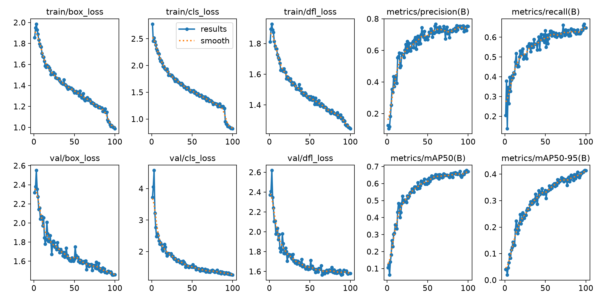

### 8.4 Teste e análise de erros

A linha "COCO sem ajuste" de `resultados/comparacao.md` sai zerada porque o COCO só mapeia para
`veiculo_na_calcada`, classe que não existe no teste; ela não mede nada aqui
([`06_avaliar.txt`](docs/execucao/06_avaliar.txt)).

| Small no teste | buraco | piso_danificado |
|---|---|---|
| falsos positivos | 88 | 10 |
| falsos negativos | 111 | 37 |
| confusão entre classes | 0 | 0 |

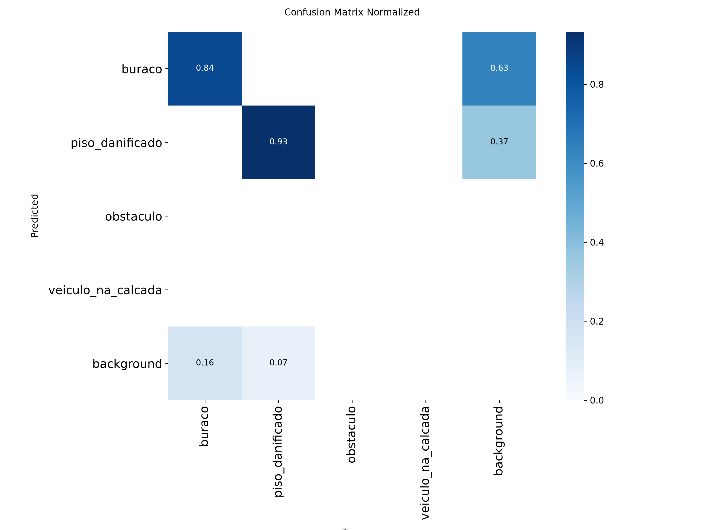

Causas observadas ([falsos positivos](docs/prints/07_falsos_positivos.jpg),
[falsos negativos](docs/prints/07_falsos_negativos.jpg)):

1. **Granularidade da anotação:** um dataset marca uma caixa em volta de um grupo de buracos, e o
   modelo marca cada buraco (ou o contrário). Conta como falso positivo e falso negativo. É a
   causa mais frequente.
2. **Sombra de árvore e faixa pintada** confundidas com buraco.
3. **Asfalto desgastado, de baixo contraste,** não detectado.
4. **Objeto na foto** (um dedo apontando) deslocou a caixa.
5. **Buraco sem anotação** no gabarito: o modelo acerta e conta como falso positivo.

A coluna `causa` do `erros.csv` fica para a equipe preencher.

### 8.5 ONNX, latência, serviço e tempo real

O ONNX bateu com o PyTorch nas 5 imagens conferidas ([`08_exportar_onnx.txt`](docs/execucao/08_exportar_onnx.txt));
`modelos/detector.onnx` tem 38 MB.

| Threads | p50 total | p95 total | Imagens/s por réplica |
|---|---|---|---|
| 1 | 87 ms | 90 ms | 11,4 |
| 2 | 49 ms | 69 ms | 19,1 |
| 4 | 34 ms | 48 ms | 27,6 |

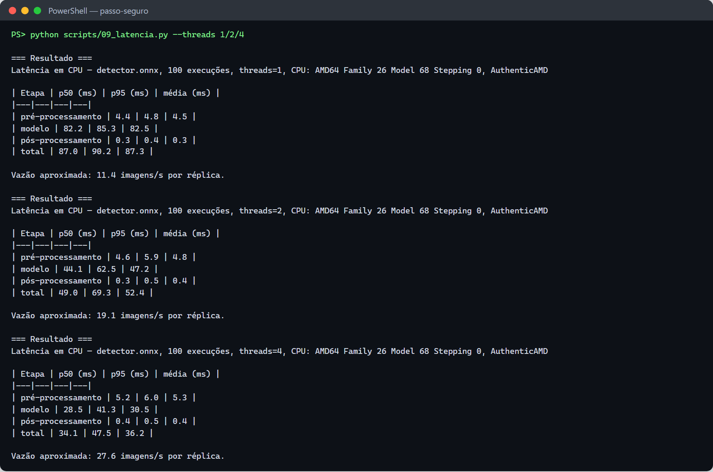

| Ambiente | Evidência |
|---|---|
| Local (`uvicorn`) | [`servico_deteccoes_local.txt`](docs/execucao/servico_deteccoes_local.txt): 401, 15 buracos numa foto em 71 ms, 422 para texto |
| Docker (531 MB) | [`servico_deteccoes_docker.txt`](docs/execucao/servico_deteccoes_docker.txt): 2 buracos em 86 ms, healthcheck `healthy` |

**Tempo real:** sem vídeo de caminhada, o `10_tempo_real.py` rodou sobre um slideshow de 30
fotos de teste: **31,2 FPS em CPU** ([`10_tempo_real.txt`](docs/execucao/10_tempo_real.txt)). Este
não é o vídeo de entrega.

### 8.6 O que falta para a entrega

| Item | Responsável |
|---|---|
| Fotos próprias de SP (300+, 6 trechos) e LGPD | equipe |
| Anotação, incluindo `obstaculo` e `veiculo_na_calcada` | equipe |
| Retreinar com as fotos de SP e repetir os passos 6.4 a 6.7 | qualquer um |
| Conferir as licenças dos datasets de buraco | equipe |
| Vídeo de caminhada real e PDF | equipe |

## 9. Dados, licenças e LGPD

- Datasets públicos e licenças: [`resultados/tabela_datasets.md`](resultados/tabela_datasets.md).
  Confira a licença dos datasets de buraco antes de publicar imagens deles.
- As fotos próprias só são publicadas depois de borrar rostos e placas e tirar todos os
  metadados (GPS incluído). `scripts/checar_lgpd.py` confere antes do push.
- O Ultralytics é AGPL-3.0, o que este repositório público atende. O serviço em produção não usa
  o Ultralytics, só o ONNX Runtime (MIT).

`dados/` fica fora do git:

```
dados/
  brutos/publicos/<dataset>/   datasets baixados (data.yaml, train/, valid/, test/)
  brutos/proprias/<trecho>/    fotos ORIGINAIS da caminhada, uma pasta por trecho (com GPS: nunca publicar)
  intermediario/               saída do 01 e do 02 (remapeado, borrado e sem metadados)
  pre_anotado/                 saída do 03, para subir no Roboflow/CVAT
  anotado/proprias/            export YOLOv8 do Roboflow (ou YOLO 1.1 do CVAT) das suas fotos
  dataset/                     dataset final do 04: train/ val/ test/ + data.yaml
  videos/                      vídeos da caminhada para o 10_tempo_real.py
```

## 10. Estrutura do repositório

```
passo-seguro-visao/
├── README.md
│
├── visao/                    pacote compartilhado: classes, caixas/IoU/NMS, detector ONNX, imagens sem EXIF
├── servico/                  FastAPI do POST /deteccoes
├── scripts/                  00 a 10 na ordem do trabalho, 01a (datasets sem login) e LGPD (borrar_manual, checar_lgpd)
├── tests/                    contrato do serviço, detector, utilitários e datasets públicos
├── config/                   classes.yaml (cópia do contrato) e datasets.yaml (fontes, licenças, remapeamento)
│
├── dados/                    fora do git: brutos/, intermediario/, pre_anotado/, anotado/, dataset/, videos/
├── modelos/                  detector.onnx + detector.json (o modelo no ar, no git)
│   ├── pesos/                melhor .pt de cada treino (fora do git)
│   ├── treinos/              saída completa do Ultralytics por treino (fora do git)
│   └── coco/                 yolo11n.pt / yolo11s.pt pré-treinados, baixados na 1ª vez (fora do git)
├── resultados/               tabelas, métricas, matrizes de confusão e erros (scripts 01, 04, 06, 07 e 09)
│
├── deploy/                   Dockerfile + Dockerfile.dockerignore do serviço
├── requirements/             servico.txt (imagem Docker), base.txt (treino e avaliação), dev.txt (+ testes)
└── docs/                     relatorio.md, roteiro-video.md, execucao/ (saídas reais), prints/
```

O build Docker usa a raiz do repositório como contexto (`docker build -f deploy/Dockerfile .`), e o
`deploy/Dockerfile.dockerignore` deixa entrar só o pacote, o serviço, as classes e o modelo.
`resultados/` vai para o PDF e para o git, exceto as pastas de imagens de erro e os vídeos.

## 11. Solução de problemas

| Sintoma | Causa e solução |
|---|---|
| `torch.cuda.is_available()` é `False` com placa NVIDIA | instale o torch pelo índice `cu130` antes do `requirements/base.txt` (seção 4) |
| `01_importar_publicos.py`: "classes sem remapeamento" | ligue cada classe do dataset a uma das 4 classes ou a `descartar` em `config/datasets.yaml` |
| baseline com mAP perto de zero | rótulos errados (classe trocada ou caixa fora do lugar), não o modelo |
| treino sem memória na GPU | `--batch 8` (ou menor) |
| `/saude` responde 503 | falta `modelos/detector.onnx`: rode o `08_exportar_onnx.py` |
| partida a frio passa dos 5 s da API | `min_replicas = 1` no Container App |

## 12. Links

- Vídeo: _link do YouTube (não listado)_

### Repositórios do projeto
- Principal: [passo-seguro](https://github.com/Passo-Seguro/passo-seguro)
- GenAI: [passo-seguro-genai](https://github.com/Passo-Seguro/passo-seguro-genai) · Dados: [passo-seguro-dados](https://github.com/Passo-Seguro/passo-seguro-dados) · Visão: [passo-seguro-visao](https://github.com/Passo-Seguro/passo-seguro-visao) · RPA: [passo-seguro-rpa](https://github.com/Passo-Seguro/passo-seguro-rpa) · Robô: [passo-seguro-robo](https://github.com/Passo-Seguro/passo-seguro-robo)
