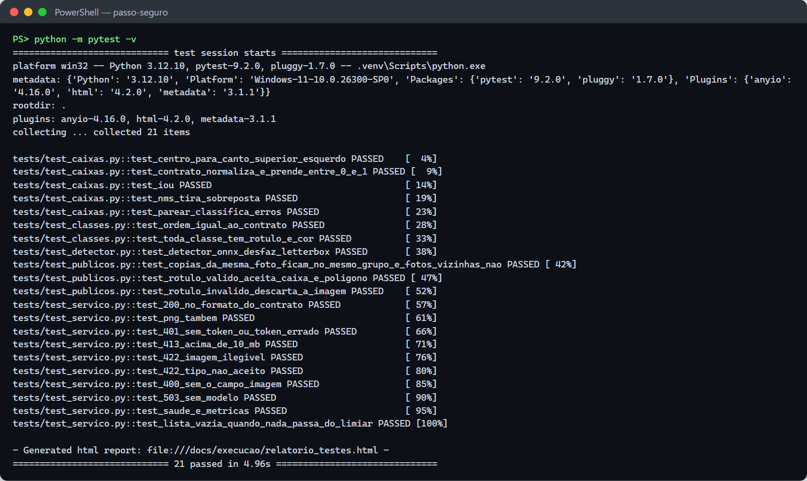

# Testes

Há duas camadas de teste:

1. **Testes automatizados (`pytest`)**: conferem o serviço, o pós-processamento e a preparação
   dos dados sem GPU e sem modelo treinado. Um ONNX falso, com a mesma interface do YOLO
   exportado (entrada `1×3×640×640`, saída `1×(4+4)×8400`), é gerado na hora por
   [`tests/conftest.py`](../tests/conftest.py). Rodam em cerca de 5 s.
2. **Avaliação do modelo**: métricas no conjunto de teste (`06_avaliar.py`), análise de erros
   (`07_analise_erros.py`), latência em CPU (`09_latencia.py`) e o serviço com o modelo real. Os
   números estão no [README](../README.md#resultados) e em [`execucao/`](execucao/).

## Como rodar

```powershell
.venv\Scripts\Activate.ps1
python -m pytest -v                                    # todos
python -m pytest tests/test_servico.py -v              # um arquivo
python -m pytest -k 422 -v                             # pelo nome
python -m pytest --html=docs/execucao/relatorio_testes.html --self-contained-html   # relatório HTML
```

No VS Code: aba **Testing** (ícone de béquer), já configurada em `.vscode/settings.json`.

## Resultado da última execução

**21 testes, 21 passaram** (08/11/2026, Python 3.12.10, Windows 11). Saída completa em
[`execucao/pytest.txt`](execucao/pytest.txt) e relatório em
[`execucao/relatorio_testes.html`](execucao/relatorio_testes.html).



## O que cada teste confere

### Serviço `POST /deteccoes` — [`tests/test_servico.py`](../tests/test_servico.py)

| Teste | O que garante |
|---|---|
| `test_200_no_formato_do_contrato` | 200 com `[{classe, confianca, caixa}]`, da maior para a menor confiança |
| `test_png_tambem` | PNG é aceito, não só JPEG |
| `test_401_sem_token_ou_token_errado` | sem token ou com token errado → 401 `nao_autenticado` |
| `test_413_acima_de_10_mb` | arquivo maior que 10 MB → 413 `arquivo_grande` |
| `test_422_imagem_ilegivel` | bytes que não são imagem → 422 `dados_invalidos` |
| `test_422_tipo_nao_aceito` | tipo diferente de JPEG/PNG → 422 |
| `test_400_sem_o_campo_imagem` | multipart sem o campo `imagem` → 400 `requisicao_invalida` |
| `test_503_sem_modelo` | modelo ausente: `/saude` e `/deteccoes` → 503 `visao_indisponivel` (o serviço sobe mesmo assim) |
| `test_saude_e_metricas` | `/saude` mostra o limiar; `/metrics` conta requisições por status e detecções por classe |
| `test_lista_vazia_quando_nada_passa_do_limiar` | nada acima de 0,4 → 200 com `[]` |

### Detector ONNX — [`tests/test_detector.py`](../tests/test_detector.py)

| Teste | O que garante |
|---|---|
| `test_detector_onnx_desfaz_letterbox` | as caixas voltam para a escala da foto original (1280×960); a detecção de 0,30 some pelo limiar; duas caixas sobrepostas viram uma pelo NMS |

### Caixas e classes — [`tests/test_caixas.py`](../tests/test_caixas.py), [`tests/test_classes.py`](../tests/test_classes.py)

| Teste | O que garante |
|---|---|
| `test_centro_para_canto_superior_esquerdo` | conversão do formato YOLO (centro) para o contrato (canto superior esquerdo) |
| `test_contrato_normaliza_e_prende_entre_0_e_1` | caixa normalizada e cortada em 0..1 |
| `test_iou` / `test_nms_tira_sobreposta` | IoU e NMS corretos |
| `test_parear_classifica_erros` | a análise de erros separa acerto, falso positivo, confusão de classe e falso negativo |
| `test_ordem_igual_ao_contrato` | as classes estão na mesma ordem do enum do `openapi.yaml` |
| `test_toda_classe_tem_rotulo_e_cor` | toda classe tem rótulo e cor para o vídeo |

### Datasets públicos — [`tests/test_publicos.py`](../tests/test_publicos.py)

| Teste | O que garante |
|---|---|
| `test_copias_da_mesma_foto_ficam_no_mesmo_grupo_e_fotos_vizinhas_nao` | cópias da mesma foto (Roboflow `.rf.<hash>`) caem no mesmo split; fotos diferentes com números seguidos não são agrupadas (evita vazamento treino → teste) |
| `test_rotulo_valido_aceita_caixa_e_poligono` | caixa, polígono e imagem sem caixa são aceitos |
| `test_rotulo_invalido_descarta_a_imagem` | rótulo com texto, classe fora do `data.yaml` ou coordenada fora de 0..1 descarta a imagem |

## Testes de ponta a ponta (com o modelo treinado)

| Cenário | Como reproduzir | Evidência |
|---|---|---|
| Métricas no teste (nano × small × COCO) | `python scripts/06_avaliar.py --todos --coco` | [`resultados/comparacao.md`](../resultados/comparacao.md) |
| Latência em CPU | `python scripts/09_latencia.py --threads 2` | [`execucao/09_latencia.txt`](execucao/09_latencia.txt) |
| Serviço local com o modelo real | `uvicorn servico.app:app --port 8001` + curl | [`execucao/servico_deteccoes_local.txt`](execucao/servico_deteccoes_local.txt) |
| Serviço no container | `docker build` + `docker run` | [`execucao/servico_deteccoes_docker.txt`](execucao/servico_deteccoes_docker.txt) |
