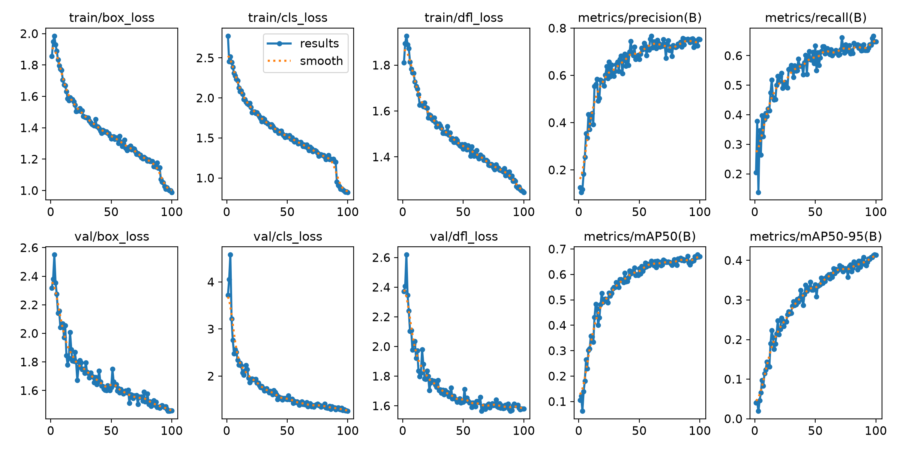
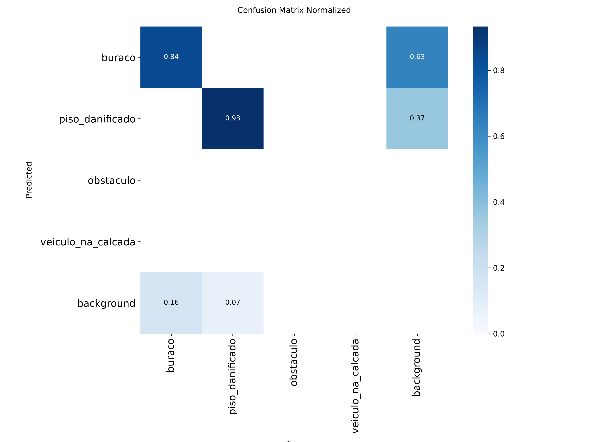
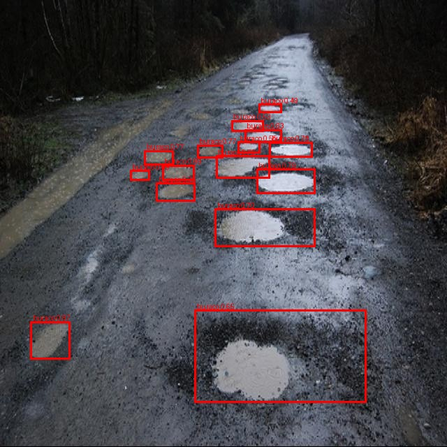

# Registro de execução — 08/11/2026

O que foi rodado nesta máquina, em ordem, com as saídas reais salvas nesta pasta e os prints em
[`../prints/`](../prints/). O guia de uso está em [`../GUIA_DE_USO.md`](../GUIA_DE_USO.md) e os
testes em [`../TESTES.md`](../TESTES.md).

> **Importante:** esta é a versão **só com dados públicos**. Não há fotos de São Paulo, porque as
> ~300 fotos próprias por trecho e a anotação delas dependem da equipe. As classes `obstaculo` e
> `veiculo_na_calcada` ficaram **sem nenhum exemplo** e o modelo não as detecta. Os números abaixo
> medem buraco e piso danificado em fotos de rua de outros países, não o desempenho em SP.

## Resumo

| Passo | Situação | Resultado principal |
|---|---|---|
| 1. Ambiente | ✅ | PyTorch 2.14.1 + CUDA 13.0, RTX 4080 (16 GB) |
| 2. Datasets públicos | ✅ | 4 datasets sem login, 2.506 imagens após limpeza |
| 3–4. Fotos próprias e anotação | ❌ | dependem da equipe (fotos de SP, LGPD, anotação) |
| 5. Dataset 70/20/10 | ✅ | 1.754 / 501 / 251 imagens, separadas por foto de origem |
| 6–7. Treino | ✅ | baseline, nano e small, 100 épocas |
| 8. Teste e erros | ✅ | **small: mAP50 0,679 · mAP50-95 0,419** no teste |
| 9. ONNX e serviço | ✅ | 87 ms por foto em CPU (1 thread); container de 531 MB `healthy` |
| 10. Tempo real | ✅ | 31 FPS em CPU, mas sobre um slideshow de fotos de teste (não há vídeo de caminhada) |
| Testes | ✅ | **21 de 21** passando |

## 1. Ambiente

| Item | Versão |
|---|---|
| Sistema | Windows 11 Pro |
| Python | 3.12.10 (venv em `.venv`) |
| GPU | NVIDIA GeForce RTX 4080, 16 GB, driver 617.14, CUDA 13.0 |
| PyTorch | 2.14.1+cu130 (torchvision 0.29.1+cu130) |
| Ultralytics / ONNX Runtime | 8.4.208 / 1.31.1 |

Seguindo o passo 1 como estava (índice `cu124`), o `pip install -r requirements.txt` trocava o
PyTorch por uma versão só-CPU sem avisar. O guia agora usa `cu130` e confere
`torch.cuda.is_available()` ([`00_ambiente.txt`](00_ambiente.txt)).

## 2. Datasets públicos — novo `scripts/01a_baixar_publicos.py`

O Roboflow Universe exige login para baixar. O script novo baixa e converte datasets abertos que
não exigem login:

| Pasta | Origem | Licença declarada | Imagens | Classe do contrato |
|---|---|---|---|---|
| `crack-seg` | Ultralytics (origem Roboflow) | CC BY 4.0 | 1.500 (limite por dataset) | piso_danificado |
| `manot-pothole` | Hugging Face `manot/pothole-segmentation` (Roboflow "road damage") | CC BY 4.0 | 309 | buraco |
| `keremberke-pothole` | Hugging Face `keremberke/pothole-segmentation` (Roboflow) | CC BY 4.0 | 90 | buraco |
| `rupesh-pothole` | Hugging Face `rupesh002/pothole-detection-dataset` | MIT | 607 | buraco |

Tabela completa, com caixas por classe: [`resultados/tabela_datasets.md`](../../resultados/tabela_datasets.md).

Problemas encontrados nos dados e tratados no script (com testes em `tests/test_publicos.py`):

- **Duplicatas:** 510 das 819 imagens do `manot` eram cópias idênticas (mesmos pixels), algumas
  em train e test ao mesmo tempo, ou seja, o próprio dataset vazava. Outras 107 se repetiam entre
  `rupesh` e os demais. O script remove repetidas por hash perceptual (dHash).
- **Rótulo corrompido:** um `.txt` de rótulo do `rupesh002` contém uma carta de apresentação. A
  imagem é descartada quando o rótulo não é válido.
- **Agrupamento:** o `01_importar_publicos.py` agrupava `images218`, `images219`… num só grupo
  ("images"), o que mandaria o `manot` inteiro para um único split. O script renomeia para
  `<foto de origem>x.rf.<hash>.jpg`: cópias da mesma foto ficam juntas e fotos diferentes não.
- **Licença a conferir:** algumas fotos dos datasets de buraco têm **marca d'água de banco de
  imagens** (ex.: "123RF", visto no vídeo de demonstração; essa foto foi deixada fora dos prints).
  A CC BY 4.0 declarada no Roboflow provavelmente não cobre essas fotos. Antes de publicar
  imagens ou o vídeo, troque esses datasets ou remova as fotos com marca d'água.

## 5. Dataset final (`04_montar_dataset.py`)

| Split | Imagens | buraco | piso_danificado | obstaculo | veiculo_na_calcada |
|---|---|---|---|---|---|
| train | 1.754 | 1.137 | 1.577 | 0 | 0 |
| val | 501 | 572 | 287 | 0 | 0 |
| test | 251 | 272 | 134 | 0 | 0 |

## 6–7. Treino (`05_treinar.py`)

| Execução | Épocas | Batch | Duração | val mAP50 | val mAP50-95 |
|---|---|---|---|---|---|
| `yolo11n_baseline_640` | 20 | 32 | 4,6 min | 0,665 | 0,367 |
| `yolo11n_final_640` | 100 | 32 | 20,9 min | 0,678 | 0,424 |
| `yolo11s_final_640` | 100 | 16 | 26 min | 0,670 | 0,414 |

Logs: [`05_treino_baseline.txt`](05_treino_baseline.txt), [`05_treino_final_n.txt`](05_treino_final_n.txt),
[`05_treino_final_s.txt`](05_treino_final_s.txt). Curvas do small:

## 8. Teste e análise de erros

`06_avaliar.py --todos --coco` no conjunto de **teste** (251 imagens; [`06_avaliar.txt`](06_avaliar.txt)):

| Modelo | mAP50 | mAP50-95 | Precisão | Recall | buraco mAP50 | piso_danificado mAP50 |
|---|---|---|---|---|---|---|
| nano baseline | 0,638 | 0,353 | 0,726 | 0,610 | 0,560 | 0,716 |
| nano final | 0,655 | 0,408 | 0,724 | 0,643 | 0,580 | 0,730 |
| **small final** | **0,679** | **0,419** | **0,764** | **0,660** | 0,583 | 0,775 |
| COCO sem ajuste | 0 | – | – | – | – | – |

**Modelo escolhido: small.** Tem o maior mAP50-95 no teste, e a latência em CPU (abaixo) fica
bem abaixo de 1 s. A linha "COCO sem ajuste" sai zerada porque o COCO só mapeia para
`veiculo_na_calcada`, classe que não existe no teste. Ela não mede nada aqui.

`07_analise_erros.py --nome yolo11s_final_640` ([`07_analise_erros.txt`](07_analise_erros.txt),
[`resultados/yolo11s_final_640/erros/`](../../resultados/yolo11s_final_640/erros/)):

| | buraco | piso_danificado |
|---|---|---|
| falsos positivos | 88 | 10 |
| falsos negativos | 111 | 37 |
| confusão entre classes | 0 | 0 |

Causas observadas, olhando as imagens ([falsos positivos](../prints/07_falsos_positivos.jpg),
[falsos negativos](../prints/07_falsos_negativos.jpg)):

1. **Granularidade da anotação:** um dataset marca uma caixa grande em volta de um grupo de
   buracos; o modelo marca cada buraco (ou o contrário). Conta como falso positivo e falso
   negativo ao mesmo tempo. É a causa mais frequente e vem da mistura de datasets com critérios
   diferentes.
2. **Sombra de árvore e faixa pintada** confundidas com buraco.
3. **Asfalto desgastado, de baixo contraste,** não detectado.
4. **Objeto na foto** (um dedo apontando) deslocou a caixa.
5. **Buraco sem anotação** no gabarito: o modelo acerta e conta como falso positivo.

A coluna `causa` do `erros.csv` não foi preenchida linha a linha: isso fica para a equipe.

## 9. ONNX, latência e serviço

`08_exportar_onnx.py --nome yolo11s_final_640` conferiu ONNX × PyTorch em 5 imagens: todas
iguais ([`08_exportar_onnx.txt`](08_exportar_onnx.txt)). O `modelos/detector.onnx` tem 38 MB.

`09_latencia.py` ([`09_latencia.txt`](09_latencia.txt)), CPU AMD, 100 execuções:

| Threads | p50 total | p95 total | Imagens/s por réplica |
|---|---|---|---|
| 1 | 87 ms | 90 ms | 11,4 |
| 2 | 49 ms | 69 ms | 19,1 |
| 4 | 34 ms | 48 ms | 27,6 |

| Ambiente | Evidência |
|---|---|
| Local (`uvicorn`) | [`servico_deteccoes_local.txt`](servico_deteccoes_local.txt): saúde com as métricas do teste, 401, 15 buracos numa foto em 71 ms, 422 para texto |
| Docker (531 MB) | [`servico_deteccoes_docker.txt`](servico_deteccoes_docker.txt): saúde, 401, 2 buracos em 86 ms, healthcheck `healthy` |

## 10. Tempo real

Não há vídeo de caminhada gravado. Para exercitar o `10_tempo_real.py`, montei um **slideshow**
com 30 fotos do conjunto de teste (1 s cada, 15 FPS). Resultado: **31,2 FPS médios em CPU** com o
ONNX ([`10_tempo_real.txt`](10_tempo_real.txt)). O vídeo anotado (`resultados/demo.mp4`) fica fora
do git; os quadros estão em [`06_tempo_real_quadros.jpg`](../prints/06_tempo_real_quadros.jpg).
**Este não é o vídeo de entrega:** grave a caminhada em SP como descrito no PASSO_A_PASSO.

## O que falta para a entrega

| Item | Responsável |
|---|---|
| Fotos próprias de SP (300+, 6 trechos), LGPD (`02_preparar_fotos_proprias.py`, `checar_lgpd.py`) | equipe |
| Anotação, incluindo `obstaculo` e `veiculo_na_calcada` | equipe |
| Retreinar com as fotos de SP e repetir os passos 5 a 10 | qualquer um (os comandos estão acima) |
| Conferir as licenças dos datasets de buraco (marca d'água) | equipe |
| Vídeo de caminhada real e PDF | equipe |
