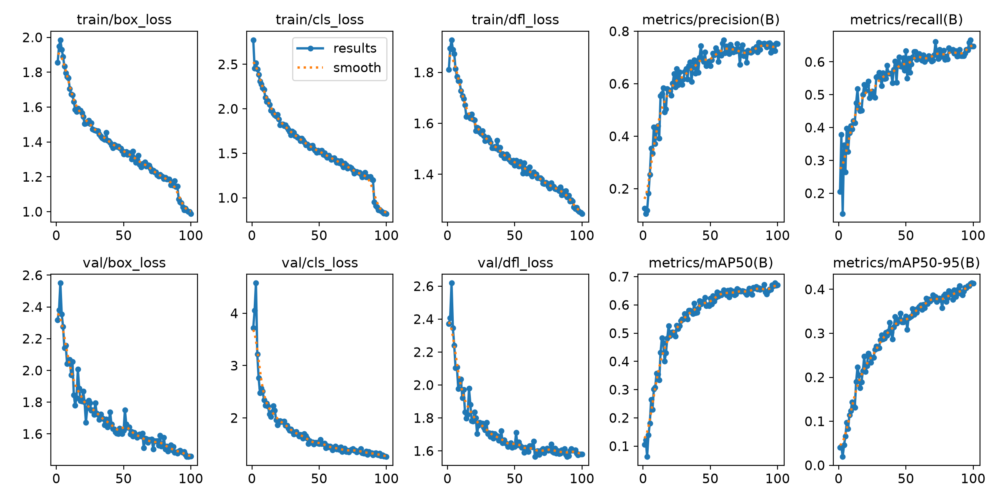
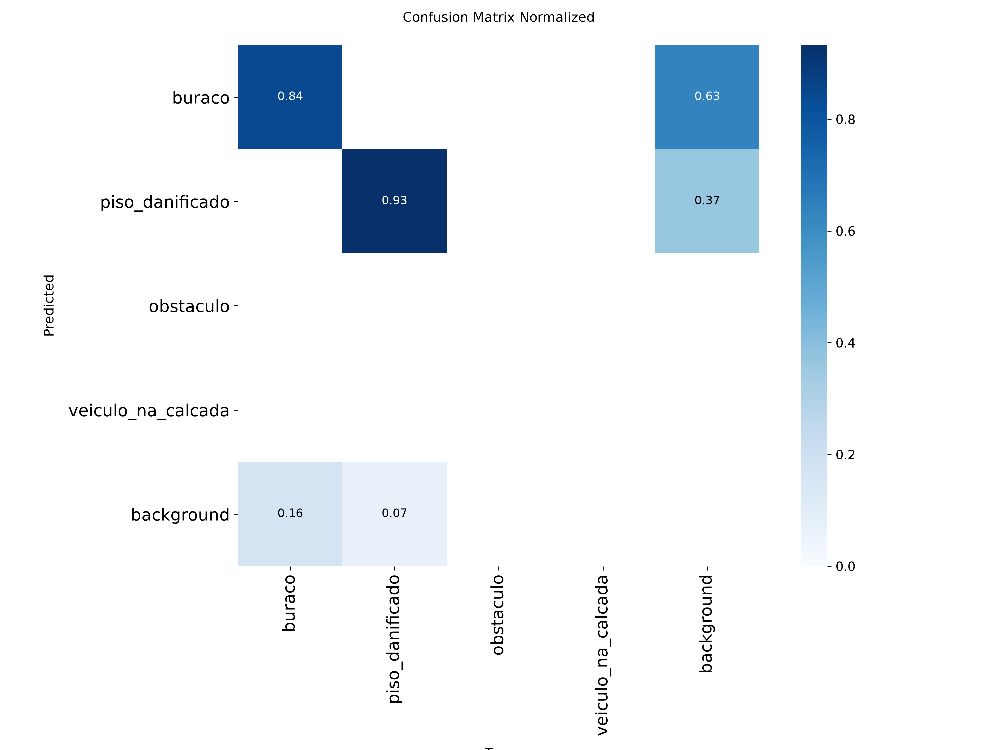
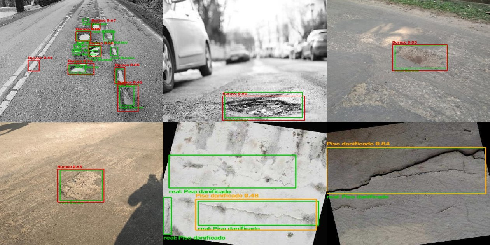
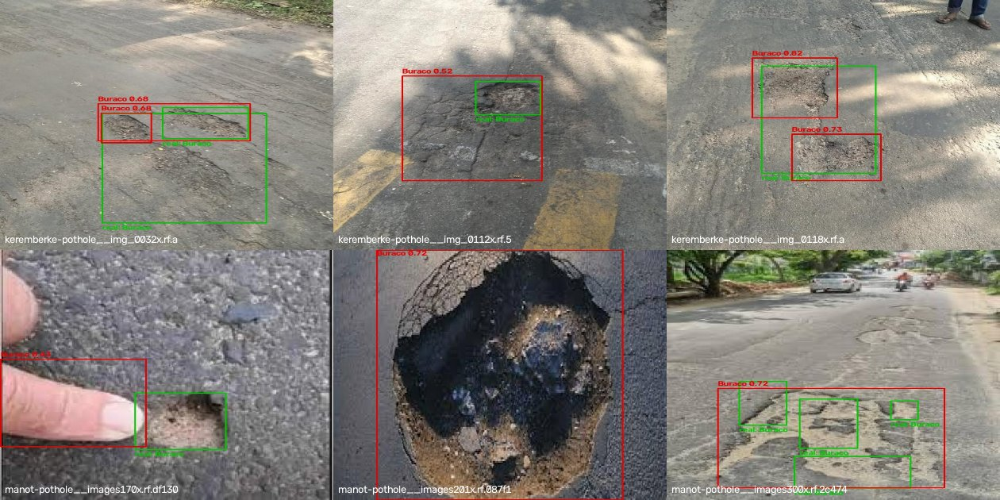
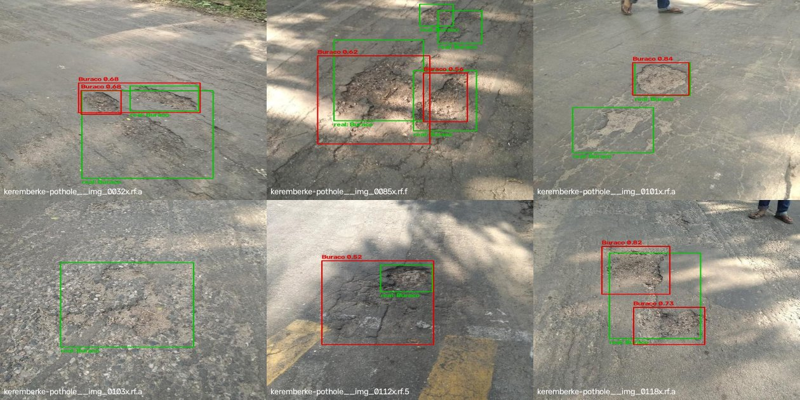
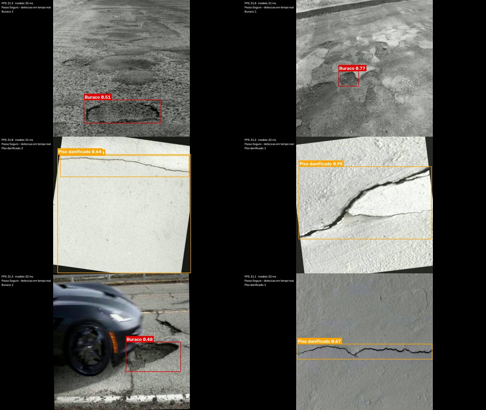
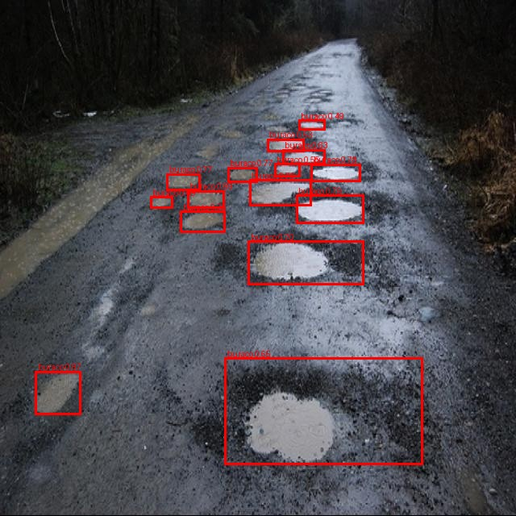

# Passo Seguro — Detector de problemas em calçadas de São Paulo

**Applied Computer Vision · Global Solution 2026.2 · CitizenTech · Engenharia de Software 4º ano**

**Integrantes:** Guilherme Morais (RM 551981) · Júlia Marques (RM 98680) · Matheus Gusmão (RM 550826)

**Repositório:** https://github.com/Passo-Seguro/passo-seguro-visao · **Vídeo:** https://www.youtube.com/watch?v=PzwxpBVbOYc

## Resumo

Calçadas danificadas causam quedas e empurram o pedestre para a rua, sobretudo idosos e pessoas
com deficiência. As solicitações sobre calçadas no SP156 cresceram mais de 200% entre 2020 e
2025, mas o canal não identifica automaticamente o tipo de problema. Este trabalho treina um
detector de objetos YOLO11 para reconhecer problemas de calçada em fotos enviadas pelo app Passo
Seguro e em vídeo, em tempo real. O contrato prevê quatro classes (buraco, piso danificado,
obstáculo e veículo na calçada); nesta versão, o modelo foi treinado com 2.506 imagens de quatro
datasets públicos, que cobrem buraco e piso danificado. Os dados passaram por limpeza: 620
imagens repetidas e um rótulo corrompido foram removidos, e a divisão 70/20/10 manteve cópias da
mesma foto no mesmo grupo, evitando vazamento entre treino e teste. Comparamos as versões nano e
small com transfer learning a partir do COCO. O small venceu, com mAP50 de 0,679, mAP50-95 de
0,419, precisão de 0,764 e recall de 0,660 no teste. Buraco foi a classe mais difícil (mAP50 de
0,583), por causa de critérios de anotação diferentes entre datasets, sombras e asfalto
desgastado. Exportado para ONNX, o modelo responde em 90 ms (p95) em CPU com uma thread, roda a
31 FPS em vídeo e atende o endpoint `POST /deteccoes`, que classifica cada relato do app.
Para cobrir as quatro classes e
medir o desempenho real em São Paulo, o próximo passo é treinar com fotos próprias das calçadas
da cidade.

## Introdução

O Passo Seguro é um app (PWA) em que o pedestre de São Paulo reporta um problema na calçada em
30 segundos, descobre quem é o responsável e acompanha o reparo. Segundo levantamento apresentado
na Câmara Municipal de São Paulo em agosto de 2026, as solicitações sobre calçadas no SP156
cresceram mais de 200% entre 2020 e 2025, chegando a 49.215. Os canais de denúncia são confusos,
e o SP156 não identifica automaticamente o problema nem agrupa relatos repetidos. A Prefeitura já
mapeia buracos no asfalto de forma automatizada, enquanto a calçada fica para trás.

A visão computacional resolve a primeira etapa: a partir da foto do relato, o sistema diz qual é
o problema e onde ele está na imagem. Essa classificação alimenta a triagem automática, que
prioriza e encaminha o relato, e o mapa de problemas. O mesmo modelo roda em vídeo, para uma
inspeção contínua durante uma caminhada.

## Objetivo

Treinar um detector de objetos para identificar, em fotos e em vídeo em tempo real, problemas de
calçada (buraco, piso danificado, obstáculo e veículo estacionado) e entregar a classe e a
posição de cada um ao Passo Seguro, para triagem e priorização dos relatos.

## Ferramentas

| Ferramenta | Para que foi usada |
|---|---|
| **YOLO11 (Ultralytics 8.4)** | Detector de um estágio: prevê caixa e classe numa única passada pela rede, o que permite tempo real. Usamos transfer learning a partir dos pesos treinados no COCO, nas versões nano (2,6 M parâmetros) e small (9,4 M). Licença AGPL-3.0, atendida pelo repositório público. |
| **PyTorch 2.14 + CUDA 13** | Treino na GPU. |
| **ONNX e ONNX Runtime** | Formato aberto do modelo e motor de inferência em CPU. O serviço não usa PyTorch nem Ultralytics, e a imagem Docker fica com 531 MB. |
| **OpenCV e Pillow** | Leitura de imagens com a orientação do EXIF, letterbox, desenho das caixas e do FPS, captura de webcam e vídeo, borrão de rostos e placas (LGPD). |
| **FastAPI + Uvicorn** | Microsserviço `POST /deteccoes`, no contrato OpenAPI do projeto, com token, limites de tamanho, métricas Prometheus e log sem dados pessoais. |
| **Docker** | Empacotamento do serviço (usuário não root, healthcheck). |
| **Datasets públicos** | Ultralytics (crack-seg) e Hugging Face (três datasets de buracos de origem Roboflow), com licenças CC BY 4.0 e MIT. |
| **pytest** | 21 testes do contrato, do pós-processamento e da preparação dos dados. |
| **Hardware de treino** | AMD Ryzen 7 9800X3D, 31 GB de RAM, NVIDIA RTX 4080 (16 GB). Treino final: 20,9 min (nano) e 26,2 min (small). |

## Metodologia

1. **Classes.** Definidas no contrato do projeto (`config/classes.yaml`): `buraco`,
   `piso_danificado`, `obstaculo` e `veiculo_na_calcada`, nessa ordem, a mesma da API.
2. **Coleta dos datasets públicos.** O script `01a_baixar_publicos.py` baixa quatro datasets
   abertos que não exigem login e os converte para o formato YOLO (os de origem COCO viram caixas
   normalizadas; os polígonos de segmentação viram caixas).

   | Dataset | Licença | Imagens | Caixas |
   |---|---|---|---|
   | Crack segmentation (Ultralytics) | CC BY 4.0 | 1.500 | 1.998 de piso danificado |
   | Road damage v3 (manot) | CC BY 4.0 | 309 | 796 de buraco |
   | Pothole Detection (keremberke) | CC BY 4.0 | 90 | 120 de buraco |
   | Pothole detection dataset (rupesh002) | MIT | 607 | 1.065 de buraco |

3. **Limpeza.** Removemos 620 imagens repetidas, comparando um hash perceptual (dHash): 510
   delas eram cópias dentro do próprio dataset manot, algumas presentes ao mesmo tempo no treino
   e no teste originais; outras 107 se repetiam entre datasets. Também descartamos uma imagem cujo arquivo de rótulo continha texto em
   vez de caixas.
4. **Remapeamento.** `01_importar_publicos.py` liga cada classe dos datasets às classes do
   contrato (ex.: `pothole` → `buraco`, `crack` → `piso_danificado`) e descarta o que não serve.
5. **Divisão 70/20/10 por grupo.** `04_montar_dataset.py` divide por foto de origem, e não por
   arquivo: cópias da mesma foto ficam no mesmo split. Resultado: 1.754 imagens de treino, 501 de
   validação e 251 de teste.
6. **Baseline.** Nano, 20 épocas, para validar o pipeline de ponta a ponta: mAP50 de 0,638 no
   teste.
7. **Treino final.** Nano e small, 100 épocas, imagem de 640, parada antecipada com paciência de
   20 e augmentation padrão do YOLO (mosaico, espelho, variação de cor e escala). Batch 32 no nano
   e 16 no small.
8. **Avaliação no teste.** `06_avaliar.py` mede mAP50, mAP50-95, precisão e recall, por classe
   e no total, e gera a matriz de confusão. `07_analise_erros.py` separa acertos, falsos
   positivos, falsos negativos e confusões, com as imagens desenhadas.
9. **Exportação e serviço.** `08_exportar_onnx.py` exporta o melhor modelo para ONNX e confere
   que ONNX e PyTorch dão as mesmas detecções. O serviço aplica o limiar de confiança de 0,4 e o
   NMS. `09_latencia.py` mede o tempo em CPU.
10. **Tempo real.** `10_tempo_real.py` lê webcam ou vídeo, detecta quadro a quadro com o ONNX em
    CPU e mostra as caixas e o FPS.



## Resultados

### Métricas no teste (251 imagens)

| Modelo | mAP50 | mAP50-95 | Precisão | Recall | ms/imagem (GPU) |
|---|---|---|---|---|---|
| YOLO11n baseline (20 épocas) | 0,638 | 0,353 | 0,726 | 0,610 | 2,0 |
| YOLO11n final | 0,655 | 0,408 | 0,724 | 0,643 | 1,9 |
| **YOLO11s final** | **0,679** | **0,419** | **0,764** | **0,660** | 2,9 |

| Modelo | buraco (mAP50 / recall) | piso danificado (mAP50 / recall) |
|---|---|---|
| YOLO11n final | 0,580 / 0,555 | 0,730 / 0,731 |
| **YOLO11s final** | 0,583 / 0,581 | 0,775 / 0,739 |

O small foi escolhido: tem o maior mAP50-95 no teste e continua rápido o bastante em CPU. O
ajuste fino é o que torna a tarefa possível: o YOLO pré-treinado no COCO não tem nenhuma classe
de buraco ou rachadura.

### Matriz de confusão



O modelo **nunca confunde buraco com piso danificado**. O erro está na fronteira com o fundo:
84% dos buracos e 93% das rachaduras são detectados, e a maior parte das caixas que sobram (sobre
o fundo) é de buraco.

### Acertos e erros

**Acertos** (vermelho e laranja: previsão; verde: gabarito):



**Falsos positivos:**



**Falsos negativos:**



| | buraco | piso danificado |
|---|---|---|
| Falsos positivos | 88 | 10 |
| Falsos negativos | 111 | 37 |
| Confusão entre classes | 0 | 0 |

Causas mais comuns, observadas nas imagens:

1. **Granularidade da anotação (a mais frequente):** um dataset marca uma caixa grande em volta
   de um grupo de buracos; o modelo marca cada buraco (ou o contrário). Conta ao mesmo tempo como
   falso positivo e falso negativo. **Correção:** padronizar o critério e reanotar, ou treinar
   com um único dataset de critério consistente.
2. **Sombras de árvore e faixas pintadas** confundidas com buraco. **Correção:** mais exemplos
   negativos (imagens de fundo com sombra).
3. **Asfalto desgastado, de baixo contraste,** não detectado. **Correção:** augmentation de
   brilho e contraste, e imagens de maior resolução.
4. **Buracos sem anotação** no gabarito: o modelo acerta, mas conta como falso positivo.
   **Correção:** revisar o rótulo das imagens de teste.

### Detecção em tempo real e serviço



| CPU (ONNX Runtime) | p50 | p95 | Imagens/s |
|---|---|---|---|
| 1 thread | 87 ms | 90 ms | 11,4 |
| 2 threads | 49 ms | 69 ms | 19,1 |
| 4 threads | 34 ms | 48 ms | 27,6 |

Em vídeo, o detector roda a **31 FPS em CPU**. No serviço `POST /deteccoes`, a resposta vem
pronta para o app: classe, confiança e caixa normalizada, da maior para a menor confiança.



```json
[{"classe": "buraco", "confianca": 0.805, "caixa": {"x": 0.3331, "y": 0.4182, "largura": 0.3729, "altura": 0.2552}},
 {"classe": "buraco", "confianca": 0.7028, "caixa": {"x": 0.4035, "y": 0.1086, "largura": 0.2167, "altura": 0.0748}}]
```

## Conclusão

O pipeline funciona de ponta a ponta: dados públicos limpos e sem vazamento, treino com transfer
learning, avaliação por classe, análise de erros, exportação para ONNX e um serviço em container
que classifica a foto do relato em menos de 0,1 s em CPU e roda a 31 FPS em vídeo. O YOLO11s
detecta bem piso danificado (mAP50 de 0,775) e razoavelmente buraco (0,583), sem confundir as
duas classes. A maior parte dos erros vem da inconsistência de anotação entre datasets, e não do
modelo.

Para a triagem do Passo Seguro, esses números bastam como apoio, mas não como decisão final:
detecções com confiança abaixo de 0,5 vão para revisão humana, e o cidadão sempre pode corrigir
a classe sugerida.

**Limitações e próximos passos:**

- treinar com fotos próprias das calçadas de São Paulo, separadas por trecho, e só então medir o
  desempenho real na cidade;
- anotar as classes `obstaculo` e `veiculo_na_calcada`, que ainda não têm exemplos;
- padronizar o critério de anotação de buraco;
- adicionar fotos noturnas e uma classe de ausência de calçada;
- substituir as poucas imagens de banco de imagens dos datasets públicos.
